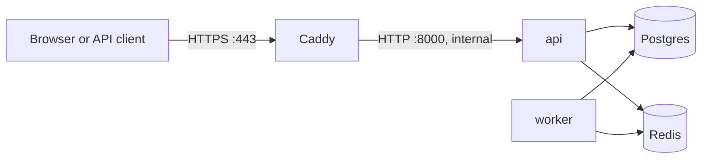

# Deploying to a server

This guide takes the service from an empty Linux server to a public HTTPS URL. It then covers updates, logs, backups and restores.

The production setup runs the same Docker Compose stack you use locally, with `docker-compose.prod.yml` layered on top. One small virtual server runs everything:



Why one server with Compose rather than a platform such as Render or Railway:

- It is the stack you already run and test locally, so nothing behaves differently in production.
- It costs a single small server.
- Every moving part stays visible.

The trade-off is that you look after the server yourself, and a single server has no failover. [DESIGN.md](DESIGN.md#8-horizontal-scaling) describes the path beyond one box.

## What the production overrides change

| | Development (`docker-compose.yml`) | Production (`+ docker-compose.prod.yml`) |
|---|---|---|
| Public ports | API 8000, Postgres 5432, Redis 6379 | Only Caddy, on 80 and 443 |
| HTTPS | None | Caddy fetches and renews a Let's Encrypt certificate and redirects HTTP to HTTPS |
| Secrets | Development fallbacks | Must be set in `.env`; Compose refuses to start without them |
| Short link origin | `http://localhost:8000` | `https://$DOMAIN` |
| Client IP for rate limits | The TCP peer | The real client, taken from Caddy's `X-Forwarded-For`; Caddy discards spoofed values |
| After a crash or reboot | API and worker restart | Every service restarts |
| Container logs | Unbounded | Capped at 3 × 10 MB per container |

## 1. What you need

- **A Linux server** running Ubuntu 24.04 LTS, with **2 GB of RAM**, 1–2 vCPUs and 20 GB of disk.
  - Any provider works: Hetzner, DigitalOcean, AWS Lightsail, Linode, Vultr and so on.
  - Both x86-64 and ARM servers work, because every image used is multi-architecture.
  - At idle the stack uses about 480 MB of RAM (measured). The headroom is for image builds and traffic. A 1 GB server works if you add swap (see Troubleshooting).
- **A domain or subdomain** you control, for example `links.yourname.dev`.
  - A free subdomain from a dynamic DNS service such as DuckDNS also works.
  - Let's Encrypt needs a real hostname. It will not issue a certificate for a bare IP address.
- **An SSH key** on your laptop. Check with `ls ~/.ssh/id_ed25519.pub`. If the file doesn't exist, create one with `ssh-keygen -t ed25519`.

## 2. Create the server

1. In your provider's console, create a server with **Ubuntu 24.04**.
2. Paste the contents of `~/.ssh/id_ed25519.pub` (print it with `cat ~/.ssh/id_ed25519.pub`) as its SSH key.
3. Note the server's **public IPv4 address**. The rest of this guide calls it `SERVER_IP`.
4. If the provider has a **cloud firewall** or security group (Hetzner Firewalls, AWS security groups, and others), allow inbound TCP 22, TCP 80, TCP 443 and UDP 443.

## 3. Point your domain at the server

1. In your DNS provider, create an **A record**: the name is your subdomain (for example `links`), the value is `SERVER_IP`.
2. If your DNS is on Cloudflare, set the record to **DNS only** (grey cloud).
   - Cloudflare's proxy would sit in front of Caddy and interfere with certificate issuance.
   - It would also make every visitor appear to come from a Cloudflare IP, which breaks per-IP rate limits.
3. Wait until the name resolves. On your laptop, `dig +short links.yourname.dev` should print `SERVER_IP`. That usually takes a few minutes.

## 4. Prepare the server

Log in from your laptop:

```bash
ssh root@SERVER_IP
```

Some providers create an `ubuntu` user instead of `root`. In that case, log in as `ubuntu` and put `sudo` in front of the commands below.

Update the system and install Docker with its official install script, which includes the Compose plugin:

```bash
apt-get update && apt-get -y upgrade
curl -fsSL https://get.docker.com | sh
docker compose version
```

Turn on the firewall. Allowing SSH first keeps you from locking yourself out:

```bash
ufw allow OpenSSH
ufw allow 80/tcp
ufw allow 443/tcp
ufw allow 443/udp
ufw --force enable
```

Docker-published ports bypass `ufw`. That is why the production overrides publish no ports except Caddy's: Postgres, Redis and the API stay unreachable from the internet whatever the firewall says.

## 5. Get the code

```bash
cd ~
git clone https://github.com/<your-username>/<your-repo>.git
cd <your-repo>
```

**If the repository is private**, give the server a read-only deploy key instead of a personal token:

1. Create the key on the server:
   ```bash
   ssh-keygen -t ed25519 -N "" -f ~/.ssh/github_deploy
   cat ~/.ssh/github_deploy.pub
   ```
2. On GitHub, open the repository's **Settings → Deploy keys → Add deploy key**, paste the key, and leave write access off.
3. Clone over SSH with that key:
   ```bash
   GIT_SSH_COMMAND="ssh -i ~/.ssh/github_deploy" git clone git@github.com:<your-username>/<your-repo>.git
   cd <your-repo>
   git config core.sshCommand "ssh -i ~/.ssh/github_deploy"
   ```

## 6. Create the production `.env`

Run this block from the repository folder. First replace `links.yourname.dev` with your hostname. It generates three random secrets and writes them to `.env`, a file git ignores:

```bash
cat > .env <<EOF
COMPOSE_FILE=docker-compose.yml:docker-compose.prod.yml
DOMAIN=links.yourname.dev
POSTGRES_PASSWORD=$(openssl rand -hex 32)
CODE_SECRET=$(openssl rand -hex 32)
API_KEY_PEPPER=$(openssl rand -hex 32)
EOF
chmod 600 .env
cat .env
```

- **`COMPOSE_FILE`** makes every plain `docker compose ...` command in this folder include the production overrides, so you never type the `-f` flags.
- **Save the printed file in a password manager.**
  - Every API key is hashed with `API_KEY_PEPPER`, so without it a database backup comes back with unusable keys.
  - `CODE_SECRET` must stay fixed for the life of the deployment.
  - Postgres keeps the password it was first started with.
- [`deploy/production.env.example`](../deploy/production.env.example) lists the optional settings, such as `WEB_CONCURRENCY` and the rate limits.

## 7. Start the stack

```bash
docker compose up -d --build --wait
```

The first run takes a few minutes. It:

1. builds the image;
2. pulls Postgres, Redis and Caddy;
3. applies the database migrations;
4. starts the API and the worker;
5. waits until all of them are healthy.

Check that everything is up:

```bash
docker compose ps
```

`postgres`, `redis`, `api`, `worker` and `caddy` should be `Up`, with `(healthy)` where a health check exists. `migrate` should be `Exited (0)`, because it is a one-shot job.

Caddy requests the certificate as it starts. Confirm that it was issued:

```bash
docker compose logs caddy | grep -i "certificate obtained"
```

## 8. Check it from your laptop

```bash
curl https://links.yourname.dev/readyz
```

It should print `{"status":"ok","checks":{"database":"ok","redis":"ok"}}`. The interactive API docs are at `https://links.yourname.dev/docs`.

## 9. Issue an API key and create a link

API keys are issued on the server. The key is printed **once**, so copy it somewhere safe:

```bash
docker compose exec -T api python -m app.cli create-api-key --name my-laptop --quiet
```

Then use the key from your laptop:

```bash
KEY=usk_paste_your_key_here
curl -s -X POST https://links.yourname.dev/api/v1/links -H "X-API-Key: $KEY" -H "Content-Type: application/json" -d '{"url": "https://en.wikipedia.org/wiki/URL_shortening", "alias": "hello"}'
```

Open `https://links.yourname.dev/hello` in a browser. It should redirect to Wikipedia. About a second later, `https://links.yourname.dev/api/v1/links/hello/stats` (with the `X-API-Key` header) counts the click.

To revoke a key, pass its first 12 characters:

```bash
docker compose exec -T api python -m app.cli revoke-api-key --prefix usk_XXXXXXXX
```

## Updating to a new version

After you push changes to GitHub, run these on the server:

```bash
cd ~/<your-repo>
git pull
docker compose up -d --build --wait
```

Compose rebuilds the image, runs any new migrations before the API starts, and replaces the containers. Expect a few seconds of downtime while the API container is swapped; avoiding that would take a second instance behind a load balancer.

Old images and build cache pile up over time. Clear them now and then with `docker image prune -f && docker builder prune -f`.

## Logs

```bash
docker compose logs -f --tail=100 api worker caddy
```

The API writes one JSON line per request, with a request id. That id also comes back in every response's `X-Request-ID` header and in every error body, so you can find the log line behind any failure a client reports.

## Backups

Take a compressed dump of the database:

```bash
mkdir -p ~/backups
docker compose exec -T postgres pg_dump -U shortener shortener | gzip > ~/backups/shortener-$(date +%F).sql.gz
```

To take one every night at 03:00, open `crontab -e` and add this line. Adjust the path if your home folder is not `/root`; the `%` signs must be escaped in crontab:

```
0 3 * * * cd /root/<your-repo> && docker compose exec -T postgres pg_dump -U shortener shortener | gzip > /root/backups/shortener-$(date +\%F).sql.gz
```

A backup that only lives on the same server dies with the server. Copy backups off it now and then, for example from your laptop:

```bash
scp "root@SERVER_IP:~/backups/*.sql.gz" ~/Downloads/
```

### Restoring a backup

Restore into an empty database, using the same `.env` the backup came from. Otherwise the restored API keys stop working.

Run `docker volume ls` and note the two volumes ending in `_pgdata` and `_redisdata`. Compose prefixes them with the folder name in lower case, for example `a-url-shortener_pgdata`. Then:

```bash
docker compose down
docker volume rm a-url-shortener_pgdata a-url-shortener_redisdata
docker compose up -d --wait postgres
gunzip -c ~/backups/shortener-2026-11-03.sql.gz | docker compose exec -T postgres psql -q -U shortener -d shortener
docker compose up -d --wait
```

The Redis volume is removed as well, so no cache entry or queued click refers to data that no longer exists. Leave Caddy's volumes alone: they hold the certificate.

## Troubleshooting

| Symptom | Likely cause and fix |
|---|---|
| `required variable ... is missing a value` | A value is missing from `.env`, or you are not in the repository folder. |
| The browser shows a certificate error, or the Caddy logs mention a failed challenge or timeout | Let's Encrypt could not reach the server. Check that `dig +short <domain>` returns `SERVER_IP`, that ports 80 and 443 are open in the provider's cloud firewall, and that Cloudflare's proxy is off. Then run `docker compose restart caddy`. Caddy backs off on its own between attempts, which keeps you under Let's Encrypt's rate limits. |
| The build stops with `Killed` or exit code 137 | The server ran out of memory during the build. Add 2 GB of swap: `fallocate -l 2G /swapfile && chmod 600 /swapfile && mkswap /swapfile && swapon /swapfile && echo '/swapfile none swap sw 0 0' >> /etc/fstab` |
| `api` never becomes healthy | Read `docker compose logs api`. If you changed `POSTGRES_PASSWORD` after the first start, change it back: Postgres keeps the original password in its volume. |
| `502` from Caddy | The API is restarting or unhealthy. Check `docker compose ps` and `docker compose logs api`. |
| `429` when creating links | The creation rate limits are working as intended. Raise `RATE_LIMIT_CREATE_PER_KEY` or `RATE_LIMIT_CREATE_PER_IP` in `.env`, then run `docker compose up -d`. |

## Security notes and what this setup does not cover

**What is exposed.** From the internet, only SSH and Caddy's ports 80 and 443 are reachable. The API trusts `X-Forwarded-For` only because nothing but Caddy can reach it.

**Secrets.** Secrets live only in `.env`. That file is readable by root alone, ignored by git, and kept out of the Docker build context by `.dockerignore`.

**Hardening worth doing.**
- Allow SSH logins by key only. Most providers already do this when you add a key at creation; check with `sshd -T | grep passwordauthentication`.
- Run as a non-root sudo user rather than root.
- Leave Ubuntu's `unattended-upgrades` enabled for security patches.

**Not covered.**
- Redirect-side rate limiting and DDoS protection, which belong at an edge or CDN.
- High availability; this is a single server.
- Off-site backup automation.
- Monitoring and alerting. A free uptime monitor pointed at `/readyz` is the cheapest first step.
